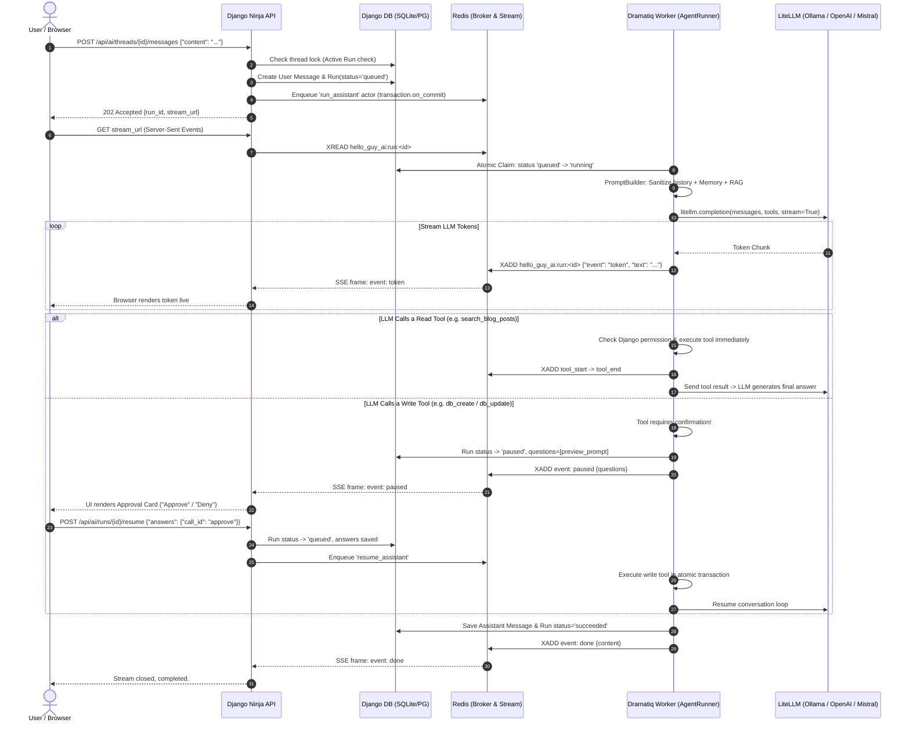

# Hello Guy AI (`hello_guy_ai`) — Master Architecture, Code Audit & Deep-Dive Guide

> **Hello Guy AI** ek production-grade, asynchronous, streaming AI agent engine hai jo natively Django ecosystem ke andar banaya gaya hai.  
> Yeh guide **Zero Knowledge** se start karke pure system ke ek-ek purze (architecture, data flow, RAG, preview policy, APIs, code review, weaknesses, aur improvements) ko deeply explain karti hai.

---

## 📑 Table of Contents
1. [Core Concept: Ye Project Kya Hai Aur Kyun Banaya Gaya? (Zero Knowledge Start)](#1-core-concept-ye-project-kya-hai-aur-kyun-banaya-gaya-zero-knowledge-start)
2. [File-by-File Codebase Anatomy (Kaunsi File Kya Karti Hai?)](#2-file-by-file-codebase-anatomy-kaunsi-file-kya-karti-hai)
3. [Deep-Dive 1: End-to-End Execution Flow (Message Se Token Tak)](#3-deep-dive-1-end-to-end-execution-flow-message-se-token-tak)
4. [Deep-Dive 2: RAG Pipeline (Document Ingestion & Retrieval Logic)](#4-deep-dive-2-rag-pipeline-document-ingestion--retrieval-logic)
5. [Deep-Dive 3: "Preieveyr Police" — Preview & Human-in-the-Loop Approval](#5-deep-dive-3-preieveyr-police--preview--human-in-the-loop-approval)
6. [Deep-Dive 4: Privacy, Security & Permissions Policy](#6-deep-dive-4-privacy-security--permissions-policy)
7. [Deep-Dive 5: API Architecture (Internal, Public, SSE Streaming)](#7-deep-dive-5-api-architecture-internal-public-sse-streaming)
8. [Deep-Dive 6: Libraries & Tools Breakdown (Konsi Kyun Chuni?)](#8-deep-dive-6-libraries--tools-breakdown-konsi-kyun-chuni)
9. [Code Audit & Review: Kya Sahi Hai? (Strengths & Best Practices)](#9-code-audit--review-kya-sahi-hai-strengths--best-practices)
10. [Code Audit & Review: Kya Galat / Risky Hai? (Flaws, Risks & Bottlenecks)](#10-code-audit--review-kya-galat--risky-hai-flaws-risks--bottlenecks)
11. [Actionable Improvement Roadmap (Kya Aur Kaise Behtar Karein?)](#11-actionable-improvement-roadmap-kya-aur-kaise-behtar-karein)
12. [Developer Cheatsheet (Quick Reference & Commands)](#12-developer-cheatsheet-quick-reference--commands)

---

## 1. Core Concept: Ye Project Kya Hai Aur Kyun Banaya Gaya? (Zero Knowledge Start)

### Problem Kya Thi?
Agar aap traditional tarike se Django me AI lagate hain (jaise direct OpenAI API call karna `views.py` me), to ye 5 major problems aati hain:
1. **Web Server Hang Ho Jata Hai**: LLM response dene me 5 se 30 seconds leta hai. Web worker tab tak blocked rehta hai. 10 users ek sath chat karenge to website crash ho jayegi.
2. **AI Hallucinate Karta Hai**: Model ko aapke private database ya documents ka pata nahi hota, to wo mann-ghadant (fake) baatein bolne lagta hai.
3. **Accidental Data Loss**: Agar aap AI ko direct database delete ya update karne ki taqat de dein, to ek galat prompt pure production database ko wipe kar sakta hai.
4. **Security Loopholes**: AI prompt injection ke zariye kisi aur user ka data padh sakta hai ya admin permissions spoof kar sakta hai.
5. **No Streaming / Terrible UX**: User ko 20 second tak blank screen dekhni padti hai jab tak pura answer ready na ho jaye.

### Is Project Ka Solution Kya Hai?
`hello_guy_ai` in paanchon problems ko elegantly solve karta hai:
- **Asynchronous Dramatiq Workers**: Web server sirf request accept karke `202 Accepted` deta hai; sari heavy processing background workers me hoti hai.
- **Real-Time Token Streaming (SSE + Redis Streams)**: User ko ek-ek word live type hota dikhta hai. Reconnect hone par bhi koi token miss nahi hota.
- **RAG (Retrieval-Augmented Generation)**: Company ke PDFs aur documentation ko Milvus vector database me store karke AI ko exact verified answers dene par majboor karta hai.
- **Preview & Approval Policy (Human-in-the-Loop)**: AI koi bhi data **Create**, **Update**, ya **Delete** karne se pehle chat screen par **Approval Card** dikhata hai. Jab tak human "Approve" button na dabaye, execution aage nahi badhti.
- **Strict Django Permission Enforcement**: Agent ke har tool execution par checking hoti hai ki jo user chat kar raha hai, kya uske paas Django me permission hai ya nahi.

---

## 2. File-by-File Codebase Anatomy (Kaunsi File Kya Karti Hai?)

`backend/hello_guy_ai/` ke andar har file ka ek dedicated, decoupled purpose hai:

```
backend/hello_guy_ai/
│
├── apps.py / admin.py / urls.py / signals.py
├── conf.py            # Settings loader (HELLO_GUY_AI in settings.py)
├── checks.py          # System checks: bad settings, missing encryption key, per-process cache
├── crypto.py          # Fernet encryption for stored LLM API keys (FIELD_ENCRYPTION_KEY)
├── knowledge.py       # Sync DB records into knowledge bases (host apps declare them in ai_knowledge.py)
├── exceptions.py      # ThreadBusy, NotAllowed, RunConflict, AssistantNotFound
│
├── models/            # chat, knowledge, llm, memory, triggers, reminders (Reminder, Notification)
│
├── core/              # Run engine (no HTTP, no admin)
│   ├── engine.py      # AgentRunner loop, tool dispatch, pause/resume, CAS status changes
│   ├── prompt.py      # History cleanup, multi-turn query rewrite, context injection
│   ├── runtime.py     # Tool abstraction, JSON schema, ContextVar, AgentSpec
│   ├── events.py      # Redis Streams (XADD/XREAD, Last-Event-ID reconnect, stop flags)
│   └── safe_expr.py   # AST-based condition evaluator (no eval/exec)
│
├── services/          # Use cases, all permission checks live here
│   ├── agents.py      # Resolve code agents + admin LLM config into an AgentSpec
│   ├── chat.py        # Threads, runs, resume/stop, feedback, public website chat
│   ├── memory.py      # Agent memory: user vs shared, feedback learning
│   ├── rag.py         # Load -> chunk -> embed (LiteLLM) -> Milvus
│   ├── reminders.py   # Reminders (exactly-once firing) + notifications (in-app, email, pluggable)
│   └── triggers.py    # post_save/post_delete + cron triggers
│
├── __init__.py        # Public API: AIAssistant, KnowledgeSource, tool, ToolError, current_context
├── assistants.py      # AIAssistant base class (code-defined agents)
├── knowledge.py       # KnowledgeSource: sync DB records into RAG (`fields = [...]` or get_text())
├── api/               # Django Ninja: __init__ (NinjaAPI), internal.py (/api/ai/), public.py (/api/ai/public/), schemas.py
├── views.py           # chat_page (full-page chat), run_stream (SSE token stream, WSGI + ASGI)
├── tasks/             # actors.py (Dramatiq actors), worker.py (worker entrypoint)
│
├── tools/
│   ├── orm.py         # Generic ORM tools: db_list_models, db_describe, db_read, db_aggregate, db_create/update/delete
│   ├── reminders.py   # get_current_datetime, create/list/update/cancel_reminder, list_notifications
│   └── knowledge.py   # search_knowledge tool for explicit RAG lookups
│
└── management/commands/
    ├── hello_guy_scheduler.py # Distributed cron runner with atomic Redis Lua lock
    └── hello_guy_reindex.py   # Bulk vector re-indexer for RAG
```

---

## 3. Deep-Dive 1: End-to-End Execution Flow (Message Se Token Tak)



---

## 4. Deep-Dive 2: RAG Pipeline (Document Ingestion & Retrieval Logic)

RAG ka kaam hai AI ko company ke specific documents (PDF, Markdown, text) padha kar unhi ke aadhar par sachhe answers dilwana.

### 4.1 Ingestion Pipeline (`services/rag.py`)
1. **Document Upload**: User Django Admin me `hello_guy_ai.Document` upload karta hai.
2. **Dramatiq Background Ingestion**: `ingest_document(doc_id)` actor trigger hota hai.
3. **Text Extraction**:
   - `.pdf` ➔ `pypdf.PdfReader` se page-by-page text extract hota hai.
   - `.md` / `.txt` ➔ Direct UTF-8 reading.
4. **Recursive Semantic Chunking (`TextChunker`)**:
   - `size=1000` characters, `overlap=150` characters.
   - Separators hierarchy: `["\n\n", "\n", ". ", " "]`.
   - Text ko blind length par cut nahi kiya jata; paragraphs aur sentences ki boundary maintain ki jaati hai. 150-char overlap context ko do tukdon me tutne se bachata hai.
5. **Batch Embedding**:
   - Model admin se chuna jaata hai: **LLM models → Type = Embedding, Default = ✔** (e.g. `mistral/mistral-embed`, API key wahi form mein). Admin mein na ho to settings `EMBEDDING_MODEL` (`ollama/nomic-embed-text`).
   - 32-32 chunks ke batches me LiteLLM call jati hai. Vector size model se khud aata hai (Mistral 1024, nomic 768).
6. **Milvus Storage (`VectorStore`)**:
   - Har embedding model ka apna collection: `hello_guy_chunks__<model>` (e.g. `hello_guy_chunks__mistral_mistral_embed`). Do models ke vectors kabhi mix nahi hote.
   - Admin mein embedding model badla → worker naya collection banake saare documents re-index karta hai (`manage.py hello_guy_reindex` se manually bhi).
   - Index: `AUTOINDEX` with `COSINE` metric.
   - **Idempotent Logic**: Naye chunks insert karne se pehle purane `doc_id` ke saare records `delete()` hote hain. Agar background task fail hoke retry ho, to duplicate vectors nahi bante.

### 4.2 Multi-Turn Query Rewriter (`core/prompt.py`)
Agar user pehle poochta hai: *"What are the charges for express delivery?"* aur agle turn me poochta hai: *"Does it include tax?"* — agar aap vector DB me *"Does it include tax?"* search karenge to delivery ka koi context nahi milega!
- `_standalone_query` function pichli chat history ko dekh kar LLM ko temperature=0 par bolta hai ki query ko rewrite kare.
- LLM rewritten query return karta hai: *"Does express delivery charge include tax?"*
- Ab vector search 100% accurate chunks utha kar lata hai.

---

## 5. Deep-Dive 3: "Preieveyr Police" — Preview & Human-in-the-Loop Approval

User ne prompt me pucha: **"how preieveyr police work"**  
Is project me iska matlab hai **Preview Policy (Human-in-the-Loop Confirmation)**.

### Kyun Zaroori Hai?
Autonomous AI agents ko bina human review ke database me naye records banana (`db_create`), existing update karna (`db_update`), ya delete karna (`db_delete`) **production suicidal** ho sakta hai.

### Implementation Architecture:
```
LLM decides to call a write tool (e.g. db_create, create_blog_draft)
                          │
                          ▼
        Tool has @tool(requires_confirmation=True)
                          │
                          ▼
           Is Run marked auto_approve=True?
             ├── YES ──► Execute tool immediately (for unattended cron triggers)
             └── NO
                  │
                  ▼
   1. Intercept execution! Do NOT run the tool function.
   2. Run tool's `confirm_prompt(args)` -> Generates Plain-English summary.
   3. Atomic update in DB: Run.status = 'paused', questions = [preview_data].
   4. Publish Redis event: "paused".
   5. SSE sends event to Browser.
   6. UI displays the "Approval Card" to the human.
                          │
         ┌────────────────┴────────────────┐
         ▼                                 ▼
   User clicks "Approve"            User clicks "Deny" / Enters Feedback
         │                                 │
         ▼                                 ▼
POST /api/ai/runs/{id}/resume       POST /api/ai/runs/{id}/resume
{"answers": {"c1": "approve"}}      {"answers": {"c1": "deny"}}
         │                                 │
         ▼                                 ▼
Worker executes the tool in DB      Tool execution permanently aborted.
and continues LLM loop.             Turn ends with denied=True.
```

### Preview Helper Code Example:
```python
def _confirm_create(args: dict) -> str:
    records = args.get("records") or []
    return f"Create {len(records)} {args.get('model')} record(s):\n{_preview(records[:3])}"

@tool(requires_confirmation=True, confirm_prompt=_confirm_create)
def db_create(model: str, records: list[dict[str, Any]]) -> dict:
    ...
```

---

## 6. Deep-Dive 4: Privacy, Security & Permissions Policy

Hello Guy AI enterprise environments ke liye 7-layer defense provide karta hai:

1. **User Identity Sandbox (`ToolContext`)**:
   - `ContextVar` use karke current user context tool ko pass hota hai.
   - LLM arguments me kabhi bhi user ki identity pass nahi kar sakta. Agar attacker prompt me kahe *"Run this as Admin"*, to bhi context hamesha real authenticated user ka hi rahega.
2. **Model Allowlist**:
   - `settings.HELLO_GUY_AI["ORM_TOOLS_MODELS"] = ["crm.lead", "shop.order"]`.
   - Jo model is list me nahi hai, AI use dhoondh hi nahi sakta (`_allowed_models()`).
3. **Django Object Permission Checks**:
   - `db_read` ➔ `user.has_perm('<app>.view_<model>')`
   - `db_create` ➔ `user.has_perm('<app>.add_<model>')`
   - `db_update` ➔ `user.has_perm('<app>.change_<model>')`
   - `db_delete` ➔ `user.has_perm('<app>.delete_<model>')`
4. **Sensitive Field Stripping**:
   - Regex `r"password|passwd|secret|token|api_?key|private|otp|salt|hash|session"` se match hone wale har field ko schema describe, read aur write teenon se silently exclude kar diya jata hai.
5. **No Relation Hopping**:
   - Attacker agar query kare `owner__password__startswith="a"`, to filters validate karte waqt double underscore traversal ko ban kar diya jata hai (`len(parts) > 2` raises `ToolError`).
6. **Row Scoping Hook**:
   - Models par `hello_guy_queryset(user)` method define kiya ja sakta hai jo user ke account/organization ke hisab se rows filter karta hai (Multi-tenancy).
7. **Safe Expression Evaluator (`core/safe_expr.py`)**:
   - Automation triggers me conditions execute hoti hain (`obj.amount > 500`).
   - Yahan `eval()` bilkul use nahi hota! Python ke `ast` module se parse karke sirf safe math aur boolean expressions run hote hain.

---

## 7. Deep-Dive 5: API Architecture (Internal, Public, SSE Streaming)

### 7.1 Internal Authenticated API (`/api/ai/*`)
- **Framework**: Django Ninja (`ninja.NinjaAPI`).
- **Authentication**: `django_auth` (Session + CSRF token).
- **Concurrency Control**: Ek thread par ek waqt me sirf ek active run ho sakta hai (`UniqueConstraint` on `[thread, status__in=['queued', 'running', 'paused']]`). Agar user previous turn ke dauran doosra message bheje to `409 Conflict (ThreadBusy)` aata hai.

### 7.2 Public Website Chat API (`/api/ai/public/*`)
- **Access**: External website visitors bina login kiye chat widget me baat kar sakte hain.
- **Sandboxed Execution**: Har request backend ke unprivileged user `PUBLIC_USER` (`website-bot`) ke context me execute hoti hai.
- **Agent Pinned**: Sirf `PUBLIC_AGENT` (`website_assistant`) chal sakta hai. Visitor internal assistants (`sales_assistant`, `content_writer`) tak nahi pahunch sakta.
- **Rate Throttling**: Anonymous IP rate limiting (`10 requests / min`).
- **Session Persistence**: Visitor ka `thread_id` (UUID) browser ke `localStorage` me save rehta hai.

### 7.3 Real-Time SSE Token Streaming (`/api/ai/runs/{id}/stream`)
- **Redis Streams Transport**: Worker tokens ko Redis Stream me `XADD` karta hai (`hello_guy_ai:run:<id>`).
- **SSE Consumer View**: `views.run_stream` Redis Stream ko `XREAD` karke chunk-by-chunk HTTP event stream deliver karta hai.
- **Reconnect Resilience**: Agar user ka Wi-Fi drop ho jaye, to browser reconnect karte waqt `Last-Event-ID` header bhejta hai. Redis Stream pichle offset se aage ke saare missed tokens replay kar deta hai!
- **Dual Server Compatibility**:
  - Under ASGI: Uses `aioredis` async iterator (`_sse`).
  - Under WSGI: Uses blocking synchronous generator (`_sse_sync`).

---

## 8. Deep-Dive 6: Libraries & Tools Breakdown (Konsi Kyun Chuni?)

| Library | Primary Responsibility | Alternative Considered | Why This Library Was Chosen? |
|---|---|---|---|
| **Django Ninja** | REST API endpoints & Swagger | Django REST Framework (DRF) | DRF bulky hai aur Pydantic v2 support nahi karta. Django Ninja extremely fast hai, clean type hints deta hai, aur native async supported hai. |
| **LiteLLM** | Unified LLM Client | Raw OpenAI SDK / LangChain | LangChain bloated hai aur fast break hota hai. LiteLLM 100+ LLM providers (Ollama, OpenAI, Gemini, Mistral, Bedrock) ko standard OpenAI syntax me wrap karta hai aur auto exponential backoff deta hai. |
| **PyMilvus (Milvus Lite)** | Vector Database | Pinecone / Chroma / pgvector | Pinecone expensive cloud-only hai. Chroma SQLite me slow padta hai. Milvus Lite bina Docker ke local file (`milvus.db`) par chalta hai aur production me high-throughput Milvus cluster par scale ho sakta hai. |
| **Dramatiq + Redis** | Background Queue | Celery | Celery configuration nightmare hai aur heavy memory consume karta hai. Dramatiq simple, fast, lightweight aur distributed task handling ke liye rock-solid hai. |
| **Redis Streams** | Real-time Token Log | Redis Pub/Sub | Redis Pub/Sub me agar browser disconnect ho jaye to data hamesha ke liye kho jata hai ("fire and forget"). Redis Streams durable log maintain karta hai jo reconnect par replay (`Last-Event-ID`) support karta hai. |
| **Pydantic v2** | Tool argument validation | Custom dict checking | Function ke standard Python type hints se automatic JSON Schema banata hai jo direct LLM tool calling schema me map hota hai. |
| **pypdf** | PDF Document Parsing | PDFMiner / Tesseract OCR | Zero external C-library dependencies. Fast, pure-Python text extraction from uploaded business manuals. |
| **croniter** | Scheduled Triggers | APScheduler | Standard Linux cron strings (`0 9 * * 1-5`) ko reliably parse karta hai. |
| **cryptography (Fernet)** | At-Rest Encryption | Plain text DB storage | User ke third-party LLM API keys ko database me encrypt karke rakhta hai taaki DB dump leak hone par keys safe rahein. |
| **Python `ast`** | Safe Expressions | `eval()` / `exec()` | `eval()` execution me zero security hoti hai (`__import__('os').system('rm -rf /')`). Python AST strictly math aur logic parse karta hai bina arbitrary code run kiye. |

---

## 9. Code Audit & Review: Kya Sahi Hai? (Strengths & Best Practices)

Is codebase me kai top-tier architectural patterns implement kiye gaye hain:

- ✅ **Compare-And-Set (CAS) State Transitions**: Database updates me atomic conditions hain:
  ```python
  Run.objects.filter(pk=self.run.pk, status=Run.Status.RUNNING).update(status=status)
  ```
  Iska fayda: Worker crash hone par, late retry aane par, ya user ke double-click karne par race conditions create nahi hoti.
- ✅ **Fail-Closed Security Design**: Agar settings me koi model define nahi hai (`ORM_TOOLS_MODELS = []`), to AI kisi bhi table ko touch nahi kar sakta. Agar knowledge base disabled hai to search zero ho jata hai; wide open nahi hota.
- ✅ **Stale Run Auto-Recovery (`_fail_stale_runs`)**: Agar worker process kill ho jaye (OOM ya server reboot), to thread hamesha ke liye lock nahi rehta. Next request par timeout check karke stale runs ko auto-fail kar diya jata hai.
- ✅ **Infinite Tool Loop Guard (`max_iterations`)**: Agent ko limit di gayi hai (default 5 to 8). Jab iterations limit par pahunchti hain, engine tool schemas empty kar deta hai, forcing the LLM to give a plain text answer instead of an infinite tool call loop.
- ✅ **Distributed Scheduler Leader Election**: `hello_guy_scheduler.py` me atomic Redis Lua script se leader lock banaya gaya hai. Agar 3 scheduler processes chal rahe hon, to sirf ek leader banta hai aur duplicate triggers fire nahi hote.
- ✅ **Anti-Poisoning Memory Rule**: Regular users sirf personal memory save kar sakte hain; shared memory sirf Django Staff members likh sakte hain. Yeh prompt-injection memory poisoning ko 100% prevent karta hai.

---

## 10. Code Audit & Review: Kya Galat / Risky Hai? (Flaws, Risks & Bottlenecks)

Yahan wo technical points hain jo production me issue create kar sakte hain:

### ⚠️ Risk 1: Milvus Lite File Lock in Multi-Process Workers
- **Issue**: Milvus Lite (`data/milvus.db`) ek local SQLite/C++ embedded file use karta hai. `VectorStore.shared()` threading lock use karta hai jo ek process ke andar safe hai.
- **The Catch**: Agar aap Dramatiq worker ko multi-process mode me run karenge (`--processes 4`), to alag-alag processes ek hi Milvus database file par concurrently write karenge, jisse database file lock crash ho sakta hai.
- **Fix**: Development me worker ko `--threads` mode me chalayein, ya production me standalone Milvus server (`http://localhost:19530`) use karein.

### ⚠️ Risk 2: WSGI Worker Starvation with Long-Lived SSE Connections
- **Issue**: `views.py` me sync SSE generator `_sse_sync` hai jo WSGI servers (Gunicorn sync workers ya Django dev server) ke liye banaya gaya hai.
- **The Catch**: Synchronous WSGI me har live connection ek entire worker process ko hold karke rakhta hai (up to 10 minutes!). Agar aapke paas 4 Gunicorn sync workers hain aur 4 users chat open karke baith gaye, to pure backend ke baaki sabhi web pages load hona band ho jayenge!
- **Fix**: Production me SSE traffic ko hamesha ASGI server (Uvicorn / Daphne) se serve karein, ya Nginx par buffering disable karein.

### ⚠️ Risk 3: Dense-Only Vector Search (No Keyword Matching)
- **Issue**: RAG pipeline sirf dense cosine embeddings (`ollama/nomic-embed-text`) par depend karta hai.
- **The Catch**: Dense embeddings semantic similarity me achhe hote hain lekin exact keyword search (jaise Invoice Numbers, Product SKUs, technical codes, ya specific names) par fail ho jate hain.
- **Fix**: Hybrid Search implement karna (BM25 keyword search + Vector Cosine similarity + Reranker).

### ⚠️ Risk 4: Public Website Thread ID Guessing
- **Issue**: `/api/ai/public/threads/{thread_id}/messages` sirf `thread_id` UUID mangta hai, koi password ya token nahi.
- **The Catch**: Halanki UUIDv4 guess karna mushkil hai, lekin agar koi visitor ka UUID leak ho jaye, to koi doosra vyakti uski poori conversation history bina kisi authorization ke dekh sakta hai.
- **Fix**: Thread create karte waqt ek signed HMAC token cookie me set kiya jaye jo subsequent calls me verify ho.

### ⚠️ Risk 5: Fixed Character Length Chunking
- **Issue**: `TextChunker` character count (1000 chars) par split karta hai, token count par nahi.
- **The Catch**: Different languages (jaise Hindi ya Code snippets) me 1000 characters ka token size bohot alag hota hai, jisse context window management unpredictable ho sakti hai.
- **Fix**: `tiktoken` ya model tokenizer se token-aware chunking implement karein.

---

## 11. Actionable Improvement Roadmap (Kya Aur Kaise Behtar Karein?)

Agar aap is project ko enterprise standard par upgrade karna chahte hain, to ye 5 improvements karein:

```
┌────────────────────────────────────────────────────────────────────────┐
│                   RECOMMENDED ARCHITECTURE UPGRADES                   │
├────────────────────────────────────────────────────────────────────────┤
│ 1. Standalone Vector Store: Deploy Milvus Standalone via Docker        │
│ 2. Hybrid RAG Search: Combine BM25 Keyword Search + Milvus Dense Vector │
│ 3. Signed Visitor Session: HMAC Signed Cookie for Public Chat Threads   │
│ 4. Vectorized Memory: Embed Agent Memories into Milvus for Cosine Recall│
│ 5. Token-Based Document Chunking: Use Tiktoken for Exact Token Budgets │
└────────────────────────────────────────────────────────────────────────┘
```

### Improvement Details:
1. **Hybrid Retrieval**:
   - Chunks ko SQLite FTS5 (Full Text Search) ya BM25 me index karein.
   - Vector Search aur Keyword Search dono ke results ko combine karke FlashRank / Cohere Reranker se top 3 chunks LLM ko dein.
2. **Visitor Security**:
   - `public_create_thread` me ek secure cookie issue karein:
     `response.set_signed_cookie("hg_visitor", str(thread.pk))`
   - Messages read karte waqt cookie signature verify karein.
3. **Semantic Memory Recall**:
   - `AgentMemory` ko database me store karne ke sath-sath uska embedding vector bhi Milvus me save karein taaki user prompt se matching memories semantically retrieve ho sakein.

---

## 12. Developer Cheatsheet (Quick Reference & Commands)

### Service Start Order:
```bash
# 1. Start Redis Server
redis-server

# 2. Run Database Migrations
python backend/manage.py migrate

# 3. Start Dramatiq Worker (One process, multi-threaded for Milvus Lite safety)
cd backend && DJANGO_SETTINGS_MODULE=config.settings python -m dramatiq hello_guy_ai.tasks.worker --threads 8

# 4. Start the scheduler (REQUIRED: reminders, cron triggers, stale runs, daily knowledge sync)
python backend/manage.py hello_guy_scheduler

# Optional, daily from cron when RETENTION_DAYS is set
python backend/manage.py hello_guy_prune

# 5. Start ASGI Server for High Concurrency Streaming
uvicorn config.asgi:application --port 8000
```

### Adding a New Assistant in 10 Lines (`ai_assistants.py`):
```python
from hello_guy_ai import AIAssistant, tool

class DevSupportAssistant(AIAssistant):
    id = "dev_support"
    name = "Developer Support"
    instructions = "You assist developers with API endpoints and code samples."
    knowledge_bases = ["api-docs"]
    has_rag = True
    memory = True

    @tool(requires_confirmation=True)
    def rotate_api_key(self, service_name: str) -> str:
        """Rotate API key for a service. Needs approval."""
        return f"Rotated API key for {service_name}"
```

---

## 13. Reminders, Notifications & Knowledge Sync

### Reminders (chat se)
- User likhta hai: *"Aaj 5 baje yaad dilana ki client ko invoice bhejna hai"*. Browser apna timezone (e.g. `Asia/Kolkata`) har message ke saath bhejta hai, jo thread pe save hota hai.
- Assistant `get_current_datetime` → `create_reminder` call karta hai. Approval card dikhta hai: *"Reminder: Send invoice to client — Today 5:00 PM (Asia/Kolkata)"*.
- Time nikal chuka ho to approval card nahi aata. Assistant poochta hai ki kya kal ka matlab tha.
- Recurring: `recurrence` cron hai (user ke timezone mein), e.g. `0 10 * * 1` = har Monday 10 baje. `run_assistant=true` ho to us time assistant khud task chalata hai (e.g. weekly sales summary) aur jawab notification mein bhejta hai.
- **Exactly once:** scheduler (`hello_guy_scheduler`, har 15s) reminder ko compare-and-set se claim karta hai, aur usi transaction mein Notification banti hai. Restart, do schedulers ya retry hone pe bhi double notification nahi jaati.

### Notifications
- In-app hamesha. Chat page pe 🔔 panel aur admin header mein "AI Chat (n new)" dikhta hai. Chat mein *"maine kaun si notifications nahi dekhi?"* poochne pe `list_notifications` unread dikhata hai aur unhe read mark karta hai (`read_at` save hota hai).
- Email: `NOTIFY_EMAIL = True` (Django `EMAIL_*` settings).
- Doosre channels (WhatsApp, Slack, SMS): `hello_guy_ai.services.reminders.notification_created` signal se jodo.

### Scheduled panel (chat UI)
Topbar mein "Scheduled (n)": saare scheduled/paused reminders aur tasks, agla time, repeat rule. **Pause** (fire nahi hoga), **Resume** (recurring agle slot se chalta hai), **Delete**.

### Knowledge sync (CMS → RAG)
Host app `ai_knowledge.py` mein batata hai ki kaunsa model, kaunsi rows, kaunsa text (dekho `cms/ai_knowledge.py`). Save/delete pe sirf woh record re-index hota hai. Text same ho to dobara embed nahi hota. Daily reconcile bulk edits pakadta hai aur orphans hatata hai (jaise app rename hone pe). App ka naam badle to sirf us app ki `ai_knowledge.py` badalti hai.

### API
| Endpoint | Kaam |
|---|---|
| `GET/PATCH/DELETE /api/ai/threads/{id}`, `GET /api/ai/threads?q=` | Thread detail, rename, delete, search |
| `GET /api/ai/notifications?unread_only=true`, `GET /notifications/unread-count`, `POST /notifications/read` | Inbox |
| `GET /api/ai/reminders`, `POST /reminders/{id}/pause\|resume\|cancel`, `DELETE /reminders/{id}` | Scheduled list |
| `GET /api/ai/health` | DB + Redis check (load balancer ke liye, no auth) |

### Settings (`HELLO_GUY_AI`)
| Key | Default | Matlab |
|---|---|---|
| `ALLOW_DELETE` | `False` | `db_delete` tabhi chalega jab True (approval phir bhi lagega) |
| `LLM_FALLBACK_MODELS` | `[]` | Main model fail ho (429, down) to ye try honge |
| `DAILY_TOKEN_LIMIT_PER_USER` | `0` | Per user daily token cap; 0 = no limit |
| `HISTORY_MAX_CHARS` | `60000` | Context window safe rakhne ke liye purane turns drop |
| `MAX_DOCUMENT_MB` | `20` | Knowledge base upload limit |
| `NOTIFY_EMAIL` | `False` | Notification email bhi bhejo |
| `RETENTION_DAYS` | `0` | `hello_guy_prune` isse purana data delete kare; 0 = kabhi nahi |

Production: `SECRET_KEY`, `FIELD_ENCRYPTION_KEY` aur `REDIS_URL` env mein zaroori hain. `manage.py check --deploy` inhe check karta hai.
