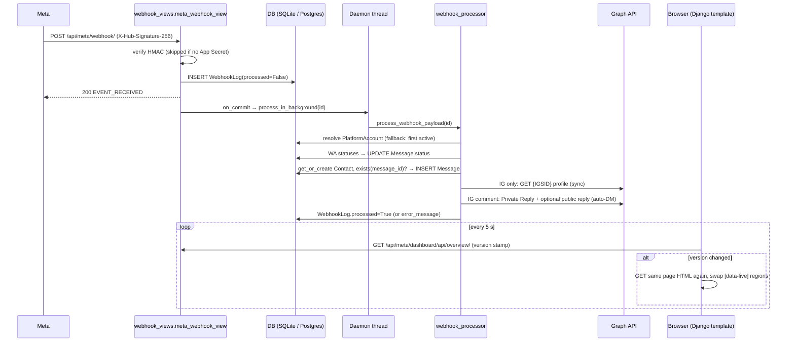

# Codebase Analysis: Meta Connector (Hello-Guys)

Phase 1 report. Read-only discovery. No code was changed.

- **Snapshot:** branch `main` at `0883d64`, **plus uncommitted work in 9 files** (account page rework, Facebook platform groundwork, sidebar grouping). This report describes the working tree as it is now, including that uncommitted work.
- **Verification run:** `manage.py test` passes (59 tests, 0 failures). `makemigrations --check` reports no model drift. `check --deploy` (local settings) reports the expected 6 dev warnings.

---

## 1. Tech stack

| Area | What is used | Notes |
|---|---|---|
| Backend framework | **Django** + Django REST Framework 3.15 | The brief mentions FastAPI. **There is no FastAPI code in this repo.** |
| Declared versions | `pyproject.toml` / `uv.lock`: Django **5.1.15**, requests ≥2.32.3, Python ≥3.11 | |
| Installed versions | `.venv`: Django **4.2.30**, requests 2.28.2, and many unrelated packages (django-rq, django-csp, django-debug-toolbar…) | **The venv does not match the lockfile.** Tests pass on 4.2. They have not been run on 5.1. |
| Database / ORM | Django ORM. SQLite locally (`backend/db.sqlite3`). Production reads `DATABASE_URL` (PostgreSQL is expected) | 8 migrations, single app |
| Background jobs | **No queue.** A daemon `threading.Thread` runs for each webhook (`services/maintenance.py:37`). Retry runs from a dashboard button or `manage.py process_webhooks` (cron) | Marked in code as `shortcut:` |
| Realtime | **Polling.** Each page with `[data-live]` regions polls `/api/meta/dashboard/api/overview/` every 5 s. When the version stamp changes, the page fetches **its own full HTML again** and swaps the regions (`base.html:221-252`) | No WebSocket/SSE |
| Auth | Django sessions for the dashboard. DRF Token + Session auth for the API (`/api/auth/token/`). Roles are Django Groups `Admin` / `Agent` / `Viewer` (`roles.py`) | Single tenant: every user sees every account |
| Frontend | Server-rendered **Django templates**. **Tailwind Play CDN** (`cdn.tailwindcss.com`, compiles in the browser at runtime). Vanilla JS. Font Awesome 6.4 (cdnjs). Inter (Google Fonts). Charts are hand-built SVG | No `package.json`, no build step, no TypeScript, no component library |
| Design tokens | CSS custom properties on `:root` and `:root.dark` (`base.html:36-48`), mapped into the Tailwind config. Light/dark/system theme and a density toggle, stored in localStorage | A good base for a design system |
| Secrets at rest | Access tokens are Fernet-encrypted (`utils.py`) with `FIELD_ENCRYPTION_KEY`. **The App Secret is stored in plain text** | See C1 and H2 |
| Deployment | `config/settings/{base,local,production}.py`, chosen by `DJANGO_ENV`. **No Dockerfile, Procfile, gunicorn config, nginx config or CI** | |
| Tooling | No linter, formatter, type checker or coverage config | |

**Environment variables read today:** `DJANGO_ENV`, `SECRET_KEY`, `DATABASE_URL`, `ALLOWED_HOSTS` (prod), `CSRF_TRUSTED_ORIGINS`, `TIME_ZONE` (default `Asia/Kolkata`), `FIELD_ENCRYPTION_KEY`, `META_WEBHOOK_ASYNC` (default `True`), `DJANGO_LOG_LEVEL`, `SECURE_SSL_REDIRECT`, `SECURE_HSTS_SECONDS`.
All Meta settings (verify token, app secret, Graph version, accounts, tokens) are stored **in the database** and edited at `/dashboard/settings/`. They are not env vars. The README mentions a `.env.example` file. **That file does not exist.**

---

## 2. Folder map

```
/                         uv project root: pyproject.toml, uv.lock, requirements.txt (duplicate of backend/requirements.txt), README.md (duplicate of backend/README.md)
backend/
  manage.py
  config/                 Django project
    settings/base.py      apps, DRF, logging, DB, FIELD_ENCRYPTION_KEY, META_WEBHOOK_ASYNC
    settings/local.py     DEBUG, ALLOWED_HOSTS=*, ngrok CSRF origins
    settings/production.py  DEBUG off, HTTPS/HSTS/secure cookies, DATABASE_URL required
    urls.py               /admin, /api/auth/token, /dashboard/* pages, includes /api/meta/
  meta_connector/         the only app
    models/               PlatformAccount, Contact, Message, WebhookLog, MetaConfig (singleton), AutoDMRule, AutoDMLog
    services/
      webhook_processor.py  parses WA + IG payloads → Contact/Message rows (the inbound core)
      whatsapp_service.py   send text/template via Cloud API
      instagram_service.py  send DM, Graph reads (profile, media), private reply, public comment reply
      message_service.py    outbound send + persistence for both channels
      auto_dm_service.py    comment → Private Reply ("comment-to-DM") rule engine
      token_service.py      /debug_token health, User → long-lived → Page token upgrade
      profile_service.py    IG profile enrichment, email extraction from message text
      maintenance.py        background thread runner, retry of failed/stuck webhooks, log retention, signature-failure counter
    views/
      webhook_views.py    GET verify / POST ingest
      api_views.py        DRF: contacts list, messages list, send
      dashboard_views.py  Overview page + polling endpoint
      insights_views.py   analytics aggregation for Overview
      contact_views.py    conversation page + reply
      account_views.py    per-account page (+ IG posts & auto-DM rules)
      settings_views.py   Meta app config, accounts, team, webhook actions
    templates/dashboard/  base, index (Overview), contact_detail, account_detail, settings, login, partials
    roles.py              Admin/Agent/Viewer, decorator, DRF permission
    context_processors.py sidebar account groups, role flags, webhook health banner
    forms.py, serializers.py, admin.py, utils.py (encryption, HMAC, header redaction)
    management/commands/  process_webhooks, cleanup_webhook_logs
    tests/                9 modules, 59 tests (Meta mocked with unittest.mock)
docs/                     this report
```

---

## 3. Meta integration map

### 3.1 Graph API usage

- Base URL: `https://graph.facebook.com/{MetaConfig.graph_api_version}`. The default version is **`v21.0`** and can be changed in Settings. Check that this version is still supported before you go live.
- Timeouts: 10 s (5 s for profile lookups). **No retry, no backoff, no rate-limit handling.**
- Errors: the code reads only `error.message`. The **only error code it handles** is **190** (invalid token), and only in `InstagramService._graph` (`instagram_service.py:110`). Sends through `send_instagram_message` / `send_whatsapp_message` do not flag a dead token. Codes 4/17/32/613 (rate limits), 10/200 (permissions), WA 131047 (re-engagement / window closed), 131056/130429 (throughput) and 131026 (undeliverable) are not recognised. The UI shows them as plain text.
- Some calls put tokens in **query strings** (`profile_service.py:56`, all of `token_service.py`) instead of the `Authorization` header. See H1.

### 3.2 Instagram

| Capability | Status | Where |
|---|---|---|
| Login model | "Instagram API with **Facebook Login**" (Page token, `graph.facebook.com/me/messages`). The newer "Instagram API with Instagram Login" (`graph.instagram.com`, IGAA tokens) is not supported | `instagram_service.py:39` |
| OAuth flow | **None.** An admin pastes a token in Settings | `forms.py:30` |
| Token upgrade | A pasted **User** token is exchanged for a long-lived token (`fb_exchange_token`, needs the App Secret). Then the code finds the Page linked to the IG account and stores that **Page token** (never expires). Page/System-User tokens are stored as pasted | `token_service.py:43-88` |
| Token health / refresh | `/debug_token` runs **on page loads** when the last check is >12 h old (`refresh_stale`). The token is marked invalid on error 190. Required scopes are checked. **There is no scheduled refresh** and no re-exchange before data-access expiry | `token_service.py`, `account.py:120-140` |
| Inbound DMs | `entry[].messaging[]`: text, attachments (image/video/audio/file). **Only the first attachment is kept.** | `webhook_processor.py:241-357` |
| Echoes (sent from IG app / our API) | Saved as outgoing, de-duplicated by `mid` | `webhook_processor.py:214-238` |
| Reactions | Handled, but **broken** (see H5) | `webhook_processor.py:277-298` |
| Comments | `entry[].changes[field=comments]` is saved as a `comment` Message, then the auto-DM rules run | `auto_dm_service.py` |
| Comment-to-DM | Per-post rule or account default rule. Keyword match (substring, OR). One DM per user per post. Optional public reply. Uses Private Replies (`recipient.comment_id`) | `auto_dm_service.py`, `models/autodm.py` |
| Mentions, story mentions, story replies, shares/reels in DMs, postbacks, quick replies, `messaging_seen`, message edit/unsend, referrals | **Not handled.** Story mentions / shares are stored as `unknown`. The other events are dropped | — |
| Outbound | Text only. No media, no quick replies, no `HUMAN_AGENT` tag (7-day window) | `instagram_service.py:16` |
| Media / profile reads | `GET {ig_id}?fields=…`, `GET {ig_id}/media` (cursor paging), called **live on every account page render** | `account_views.py:89-90` |
| Contact profile | `GET {IGSID}?fields=name,username,profile_pic`, run synchronously while the webhook is processed | `profile_service.py:41` |

### 3.3 WhatsApp

| Capability | Status | Where |
|---|---|---|
| Identity | `PlatformAccount.phone_number_id` only. **WABA ID is not stored** | `models/account.py` |
| Inbound types | text, image, video, audio, document, sticker, location, reaction, interactive (button/list reply → text). `button` (template quick-reply), `contacts`, `order`, `system`, `unsupported`, `errors` → `unknown` or ignored | `webhook_processor.py:130-191` |
| Inbound media | Only `media_id` + mime are stored. **Media is never downloaded** (needs `GET /{media-id}` and then an authenticated download). The UI cannot show WA images, audio or documents | — |
| Outbound | Text, or a template **by name only**: language is hard-coded to `en_US`, **no `components`/variables**, no media send | `whatsapp_service.py:60-81` |
| Templates management | **None** (no list/create/sync of `message_templates`, no approval status) | — |
| Status updates | `statuses[]`: sent/delivered/read/failed are mapped and saved. **Out-of-order updates can move status backwards**, and `errors[]`, `pricing`, `conversation` are discarded | `webhook_processor.py:76-91` |
| 24-hour window | Only **shown** on the contact page (last incoming non-comment message + 24 h). **Not enforced** on send, and no template fallback in the UI | `contact_views.py:11,44-56` |
| Quality rating / messaging limits / number status | **None** | — |

### 3.4 Webhooks

| Concern | Implementation | Where |
|---|---|---|
| Endpoint | `GET/POST /api/meta/webhook/`, CSRF-exempt | `webhook_views.py` |
| Verification | `hub.mode=subscribe` and the token matches `MetaConfig.verify_token` **or** any active `PlatformAccount.verify_token` → echo `hub.challenge`. Uses `==`, not a constant-time compare | `webhook_views.py:27-51` |
| Signature | HMAC-SHA256 of the raw body with the App Secret, compared with `hmac.compare_digest`. Failures are counted and shown in a banner. **The check is skipped when no App Secret is set** | `utils.py:68-93` |
| Persistence | Every accepted POST is stored in `WebhookLog` (payload + headers with secret headers redacted) **before** processing | `webhook_views.py:76` |
| Async | `META_WEBHOOK_ASYNC=True` (default): returns `200 EVENT_RECEIVED` right away and processes in a daemon thread after commit | `maintenance.py:37-48` |
| Idempotency | `Message.message_id` is unique. The code checks "exists" before it creates the row (race-prone, see M1). Comments are de-duplicated by comment id, auto-DMs by `AutoDMLog.comment_id` (unique) | `webhook_processor.py` |
| Retries | Logs that are failed or stuck (>2 min unprocessed) are re-processed by the admin banner button or `manage.py process_webhooks` | `maintenance.py:51-63` |
| Retention | Processed logs are deleted after N days (Settings). Failed logs are kept for ≥90 days. Cleanup runs at most once a day | `maintenance.py:14-27` |
| Unknown account | The event goes to the **first active account of that platform**, and that account's ID can be overwritten (see H6) | `webhook_processor.py:70-74,256-260` |

---

## 4. Data flows

### 4.1 Inbound message → UI



### 4.2 Outbound message → status → UI

```mermaid
sequenceDiagram
    participant UI as Contact page form / POST /api/meta/send/
    participant MS as MessageService.send_message
    participant API as WhatsApp Cloud API / IG Send API
    participant DB as DB
    participant Meta as Meta webhooks
    participant WP as webhook_processor

    UI->>MS: platform, to, text, [template_name], [account_id]
    MS->>DB: get_or_create Contact
    MS->>API: POST /{phone_number_id}/messages or /me/messages (sync, 10 s timeout, no retry)
    API-->>MS: wamid / mid, or error
    MS->>DB: update_or_create Message(status=sent|failed; failed ones get a fake id)
    MS-->>UI: redirect + flash message (form) / 201 or 502 (API)
    Meta->>WP: WA statuses (delivered/read/failed) or IG echo
    WP->>DB: UPDATE Message.status (no ordering guard) / save echo if not already stored
    Note over UI: The next poll sees a new version and re-renders the ticks
```

---

## 5. Existing UI inventory

All pages are server-rendered and extend `dashboard/base.html` (sidebar, mobile drawer, flash messages, token and webhook alert banners, Display panel). Forms do full-page POST → redirect → flash.

| Page | Route | What it does | Data source | Current problems |
|---|---|---|---|---|
| Login | `/dashboard/login/` | Username/password sign-in | Django `LoginView` | Separate copy of the tokens and styles (not shared with base). Tailwind runtime CDN |
| **Overview** | `/dashboard/` | 6 KPIs with deltas (7/30/90 d). Messages-per-day stacked SVG chart + table fallback. Plain-language "takeaways". Contacts table (**top 100 only**, search/filter **in the browser only**). Recent 12 messages. By-account bars, top contacts, replies by team, auto-DM stats, weekday×hour heatmap | `insights_context()` + polling `/api/meta/dashboard/api/overview/` | **Loads every message of 100 contacts** to show a count (H7). Each live update re-renders the whole page on the server. Contacts after #100 cannot be found. "View all" goes to Django Admin. No inbox/unread concept. Chart tooltips work with a mouse only (no keyboard/touch). Heatmap has no data-table fallback. No loading skeletons |
| **Contact / conversation** | `/dashboard/contacts/<pk>/` | Chat thread (DMs, comments, auto-DMs, echoes), status ticks, 24 h window pill, composer (Enter to send), details, counts, auto-DM history | Template + full-page live swap | **Shows the oldest 500 messages, so newer ones never appear** (H3). No media preview (WA has no URL; IG shows an "Open attachment" link only). Reactions show as separate bubbles. Composer stays enabled when the window is closed. No template picker, no attachments, no retry for a failed send. No optimistic send (full reload). New messages are not announced to screen readers (no `aria-live`) |
| **Account** | `/dashboard/accounts/<pk>/` | IG: live profile header, KPIs, default auto-DM form, posts/reels grid with per-post rule forms, comment activity (25). All channels: contacts (25) + recent messages (25) | **Live Graph calls on every render** (profile + media) + `refresh_stale()` | Slow, can hit rate limits (H8). Uses `prefetch_related('messages')` + `.count` (H7). `c.phone_number` field does not exist (L3). Table rows are clickable with the mouse only. "Use default" deletes a rule with no confirmation. No KPIs for WA quality/limits |
| **Settings** (Admin) | `/dashboard/settings/` | Webhook URL + verify token (copy). Meta app form (name, verify token, App Secret, Graph version, log retention). Accounts list with token health. Add/edit/delete account. Team (add member, change role, remove access) | Forms | Role `<select>` **submits on change** (WCAG 3.2.2). "Remove access" has no confirmation. Token errors can contain secrets (H1). No reconnect/OAuth. No webhook subscription status from Meta |
| Webhook actions | `POST /dashboard/webhooks/` | Retry failed/stuck webhooks, dismiss signature warning | — | Error details only in Django Admin |
| 403 | template | Role denial page | — | Unstyled, hard-coded colours, Tailwind CDN |
| Django Admin | `/admin/` | Used as the "view all messages", "webhook logs" and "edit contact" UI | — | Not part of the product UI. Shows `verify_token` in the list. The App Secret can be edited in plain text |

**Problems that affect every page**

- **Accessibility:** the mobile drawer has no focus trap or `aria-expanded`. Off-canvas sidebar links can be reached with Tab while hidden on mobile (they are moved off-screen, not hidden). Status is shown by an icon plus `title` only (no text on touch or for assistive tech). No `aria-live` on live regions. Contrast was **not measured**. The tokens look AA-safe for body text, but this is not verified.
- **States:** empty states exist and are good. **Loading skeletons and retryable error states do not exist** (server rendering). Errors arrive as flash messages after a reload.
- **Performance:** Tailwind compiles in the browser at runtime on every page load. Each live update makes N open tabs re-render full pages on the server. No pagination in the UI.
- **Design system:** the tokens are solid (`--bg/--surface/--ink/--accent/--ok/--warn/--bad/--wa/--ig`, density). But many magic values (`text-[13px]`, `h-[42px]`, hex colours in `admin.py` and `account.py:110`) and copy-pasted avatar/badge markup are repeated across 5 templates.

---

## 6. Issues found (ranked)

### Critical

| # | Issue | Evidence | Impact |
|---|---|---|---|
| C1 | **Hard-coded fallback encryption key.** If `FIELD_ENCRYPTION_KEY` is unset, every environment (including production) silently encrypts tokens with a key committed in the repo. An invalid key also silently derives a different key | `utils.py:12,23-36`, `settings/base.py:132` | Anyone with repo access and a DB copy can decrypt all Meta access tokens. Changing the key later breaks decryption with no warning |
| C2 | **Webhook signature check is off when no App Secret is saved**, and it is blank by default. Production does not force it | `utils.py:73-75`, `webhook_views.py:55`, `models/config.py:21` | Anyone can POST forged events: fake messages and contacts, changed message statuses, auto-DM triggers (outbound sends from your account), overwritten account IDs (H6). Settings only shows a warning pill |

### High

| # | Issue | Evidence | Impact |
|---|---|---|---|
| H1 | **Secrets leak through network-error text.** `requests` errors include the full URL with its query string (verified locally). `TokenService._get` sends `input_token`/`access_token`/`client_secret` as query params and stores `"Could not reach Meta: {exc}"`. That text goes to `PlatformAccount.token_error` (DB), Settings flash messages and logs. `ProfileService` logs `exc` with `access_token` in the URL | `token_service.py:16-19,63-68,93-97`, `settings_views.py:58`, `profile_service.py:53-56,88-89` | Access tokens / App Secret shown in the UI, stored in plain text and written to logs |
| H2 | **App Secret stored in plain text** (tokens are encrypted, the secret is not). Editable in plain text in Django Admin. `verify_token` shown in the admin list | `models/config.py:21`, `admin.py:9` | DB dump or admin access exposes the secret that signs webhooks |
| H3 | **Conversation shows the oldest 500 messages.** `order_by('created_at')[:500]` | `contact_views.py:38` | After 500 messages, new messages never appear in the chat |
| H4 | **WA status can go backwards and errors are lost.** No ordering guard (read → delivered). `statuses[].errors` discarded | `webhook_processor.py:76-91` | Wrong ticks. "Failed" with no reason. Analytics on delivery/failure are not reliable |
| H5 | **IG reactions are dropped.** `reaction.mid` is the id of the message being reacted to, which is already stored, so the `exists()` check skips the reaction. Unreact is ignored. The fallback id uses a timestamp (not idempotent) | `webhook_processor.py:280-281` | Reactions never show for normal conversations |
| H6 | **Events for unknown accounts are misrouted.** An unknown `phone_number_id` / IG entry id falls back to the *first active account* and can **overwrite** its empty ID. `get_or_create_default_account` creates placeholder accounts | `webhook_processor.py:70-74,256-260`, `message_service.py:19-31` | Messages are filed under the wrong number. Replies go out from the wrong number. Combined with C2, an attacker can claim accounts |
| H7 | **Unbounded memory / N+1.** `prefetch_related('messages')` and `{{ c.messages.count }}` load **all messages** of 100 contacts (Overview) / 25 contacts (Account) on each render and each live update. `ContactSerializer.message_count` runs one query per row | `dashboard_views.py:24`, `index.html:162`, `account_views.py:31-35`, `serializers.py:71` | Pages get slower as data grows. Can exhaust memory |
| H8 | **Synchronous Meta calls in page requests and live updates.** `refresh_stale()` (up to 10 s per account) on Overview/Account/Settings. `get_profile` + `list_media` on every IG account render. A live update re-renders those pages for every open tab | `dashboard_views.py:25`, `account_views.py:22,89-90`, `base.html:232` | Slow pages, Graph API rate limits, cascading timeouts |

### Medium

| # | Issue | Evidence |
|---|---|---|
| M1 | Background processing is a daemon thread per webhook. On SQLite, concurrent writers get `database is locked`. Work is lost on restart (retry mitigates this). Dedupe is "check-then-insert", not atomic: a concurrent duplicate raises `IntegrityError` and fails the rest of that payload (the payload is not processed in a transaction) | `maintenance.py:37`, `webhook_processor.py:109,193` |
| M2 | 24 h window is not enforced. Template send has no components/variables and a hard-coded `en_US`. Send API requires `text` even for templates. No template UI | `whatsapp_service.py:21,60-70`, `serializers.py:119` |
| M3 | Send API validation gaps: `account_id` is not checked against `platform` (a WA account can be sent through the IG endpoint with the WA token). No idempotency key (a double submit sends twice). No throttling | `message_service.py:57-63`, `api_views.py:89` |
| M4 | API exposes raw Meta payloads (`Message.raw_payload`, `Contact.raw_profile_data`) to every Viewer | `serializers.py:63,97` |
| M5 | Facebook Messenger can be added in the UI (uncommitted work), but `object=page` webhooks are routed **only** to Instagram accounts, so FB accounts never receive messages | `webhook_processor.py:30,250-254`, `forms.py:48` |
| M6 | WA media never downloaded. IG CDN URLs expire. IG story replies/mentions, shares, postbacks, seen, edits/unsends are not handled. Only the first IG attachment is kept | §3.2, §3.3 |
| M7 | No retry/backoff, no rate-limit or Meta error-code handling. Error 190 is handled only in `_graph`, not in send paths | §3.1 |
| M8 | Tailwind Play CDN in production (Tailwind documents it as not for production). Runtime JIT. Third-party scripts block any strict CSP | `base.html:17`, `login.html:8`, `403.html:3` |
| M9 | No server-side pagination or search in the UI. Contacts capped at 100. The API uses offset (page-number) pagination, not cursors | `dashboard_views.py:24`, `settings/base.py:117` |
| M10 | Tokens in query strings (proxy/access-log exposure), apart from H1 | `profile_service.py:56`, `token_service.py` |
| M11 | Dependency drift: the venv has Django 4.2 / requests 2.28, but the lockfile has Django 5.1 / requests ≥2.32. `SECRET_KEY` has an insecure default that production does not override or require | `.venv`, `uv.lock`, `settings/base.py:19` |
| M12 | Messaging state is missing for an inbox: incoming `is_read` is never set true. No conversation, assignment, label or notes model (tags/notes were **removed** in migration 0003). `status` defaults to `delivered` for incoming messages | `models/message.py`, `migrations/0003` |

### Low

| # | Issue | Evidence |
|---|---|---|
| L1 | Failed verification logs the attempted verify token. Verify-token compare is not constant-time | `webhook_views.py:34,46-50` |
| L2 | A non-integer `?edit=` or `?contact_id=` causes a 500 (ValueError) instead of a 400/404 | `settings_views.py:33-34`, `api_views.py:62-64` |
| L3 | `account_detail.html:276` uses `c.phone_number`, which does not exist (should be `phone`) | uncommitted work |
| L4 | Dead or duplicated code: `SendMessageSerializer.async_send` ("Celery"). `_fetch_whatsapp_profile` is a no-op. `meta_connector:dashboard-view` duplicates `/dashboard/`. Two identical READMEs and requirements files. README structure and `.env.example` are out of date | `serializers.py:134`, `profile_service.py:93`, `meta_connector/urls.py:23` |
| L5 | `context_processors.dashboard_nav` claims to be lazy but runs an account query on **every** template render (login and 403 included) | `context_processors.py:7-14` |
| L6 | Hard-coded colours and inline styles in `admin.py`. `#0084FF` magic value in the model | `admin.py`, `account.py:110` |
| L7 | The email regex auto-saves the first email address seen in any message (privacy/consent). The TLD is limited to 7 characters | `profile_service.py:10,102-122` |
| L8 | No CI, linter, formatter, type checking, Dockerfile/Procfile/gunicorn config | repo root |

### Test coverage gaps

The 59 existing tests cover roles, webhook verify/signature, WA/IG dedupe, echoes, auto-DM, token upgrade/health, retry/retention and the main pages. **Not covered:** WA status transitions and failure errors, WA non-text types, IG reactions/attachments, unknown-account routing, `verify_meta_signature` with an empty secret, `utils` encryption, Instagram send path, contacts/messages API filters and pagination, conversations over 500 messages, Graph error codes and timeouts.

---

## 7. Gap analysis vs. the Phase 3 target

| Target | Backend support today | Gap size |
|---|---|---|
| Unified inbox (unread, filters, assignment, labels, cursor pagination) | Contacts + messages only. No conversation entity, unread, assignee, labels or cursor API | **Large**: new models + endpoints |
| Conversation view (rich media, reactions, replies, ticks, window, templates, optimistic send) | Text send, ticks (with H4 bug), window displayed. No media download/send, no reply context, no templates | **Large** |
| Contact panel (identities, tags, notes, history) | Profile fields + history. Tags/notes were removed in 0003 | Medium |
| WhatsApp templates manager | Nothing (no WABA id stored) | **Large**: needs WABA id + `message_templates` sync |
| Automation / bot rules | Instagram comment-to-DM only (keywords, per-post/default, public reply). No DM keyword auto-replies, no WA automation | Medium (UI for the existing rules). Larger if new rule types are wanted |
| Analytics | Volume, per channel/account/agent, heatmap, auto-DM rate. **No response time, resolution, delivery/failure rate** (data partly missing) | Medium |
| Connections / settings (token health, reconnect, webhook status, WA quality/limits) | Token health yes. Manual token paste. No OAuth, no Meta webhook subscription check, no WA quality/limits | Medium |
| Activity / logs | `WebhookLog` exists, only viewable in Django Admin. API errors are not logged as entities | Small–medium |
| Realtime | 5 s polling + full-page re-render | Medium (scoped JSON endpoints, or SSE) |
| "Typed end-to-end (TypeScript)", virtualization, code splitting | No JS build pipeline at all | Depends on the frontend decision (see below) |

---

## 8. Open questions before Phase 2

These change the plan. Please answer them before I write `docs/UI_UPGRADE_PLAN.md`.

1. **Frontend architecture.** Today the UI is Django templates with no JS build. Several Phase 3 requirements (TypeScript end to end, list virtualization, code splitting, component tests, optimistic UI) assume a SPA. Choose one:
   (a) **Keep Django templates** and add a small progressive layer (for example HTMX + Alpine, or plain JS modules) with a real Tailwind build. This is the smallest change. "Typed end-to-end" would then mean typed DRF serializers / OpenAPI, not TS components.
   (b) **Add a React + TypeScript SPA** (Vite) that talks to DRF. The Django templates remain until the SPA replaces each page. This is a new framework, so it needs your approval under the hard rules.
2. **Tenancy.** Is this one business with one team (every user sees every account, as today)? Or must users see only *their* accounts? The brief says "users only see their own accounts", but the current model has no account ownership.
3. **Inbox concepts.** Do you want assignment (agent per conversation), open/closed status, labels and internal notes? These need new tables. Tags/notes were deliberately removed in migration 0003. Was there a reason?
4. **Background work.** Do you want to keep the thread-based approach (fine for low volume), or are Redis + a queue (RQ/Celery) and Postgres acceptable in production? This affects realtime (SSE/WebSocket) and Graph retries.
5. **Instagram login type.** Keep "Instagram API with Facebook Login" (Page tokens), or also support "Instagram API with Instagram Login"? Do you want a real OAuth "Connect" button (needs a Meta App Review), or is token paste acceptable?
6. **WhatsApp templates.** Do you have the WABA ID(s) and `whatsapp_business_management` scope on the tokens? Without them the templates manager cannot list approval status.
7. **Automation scope.** Is the Phase 3 rule builder limited to the existing IG comment-to-DM rules, or do you want new rule types (DM keyword auto-reply, WA auto-reply, away messages)?
8. **Uncommitted work.** 9 files have uncommitted changes (account page rework, Facebook groundwork). Should I treat them as your in-progress baseline and build on them, or will you commit or discard them first?
9. **Fix order.** I suggest fixing C1, C2, H1–H6 first, as small separate commits before any UI work, because the new UI depends on correct data. Do you agree?
